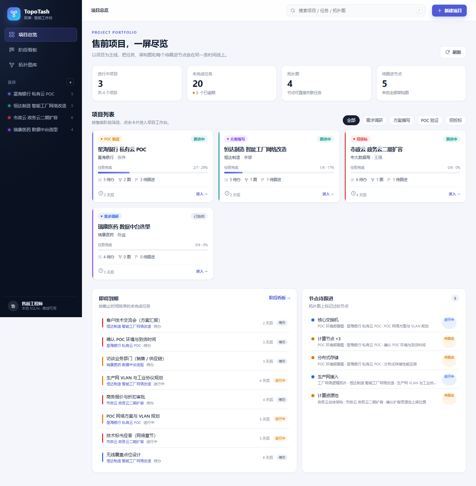
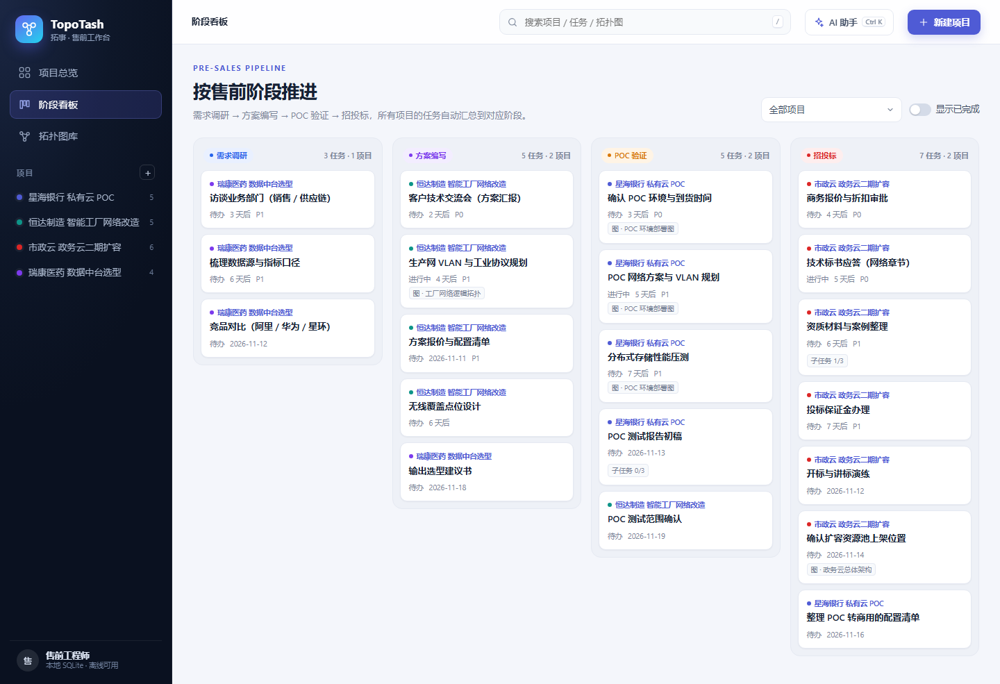
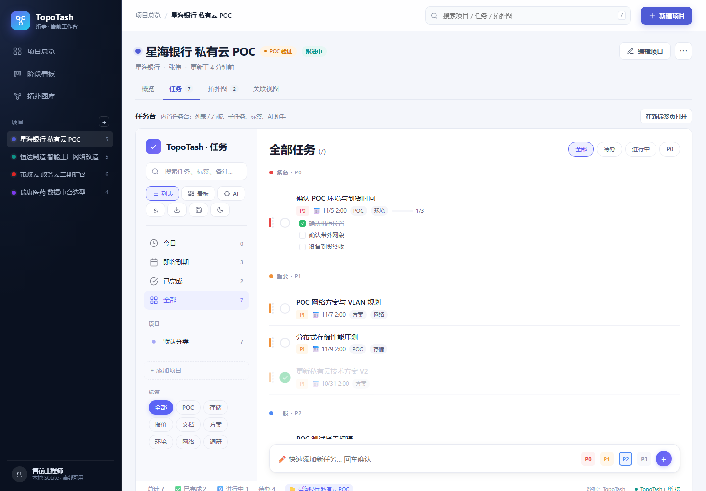
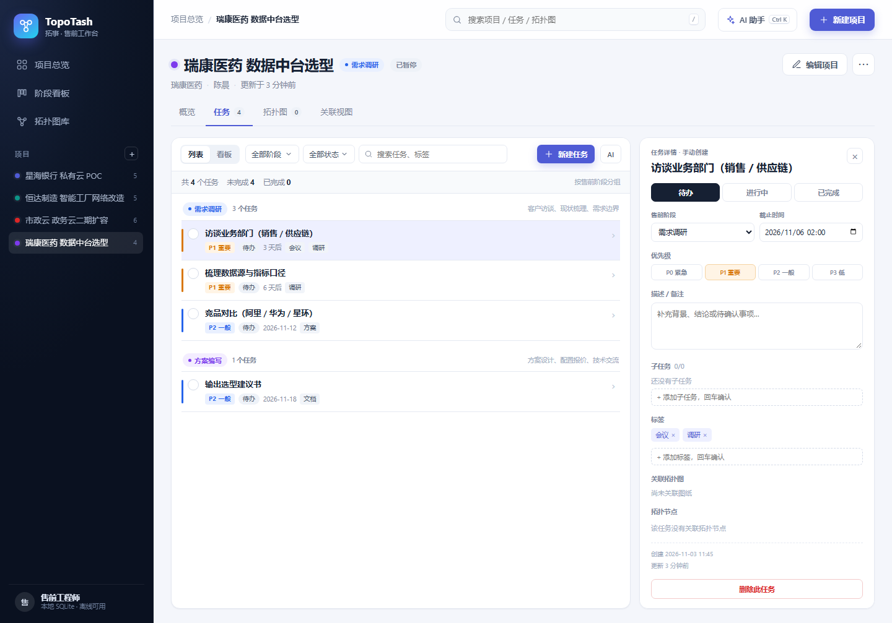
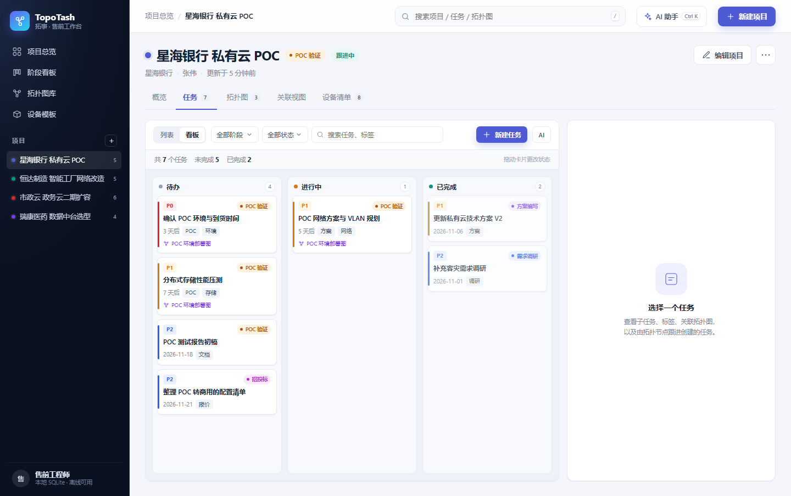
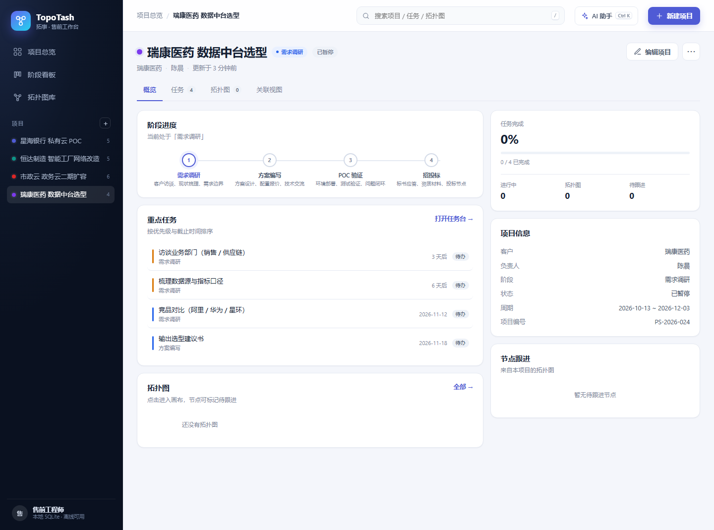
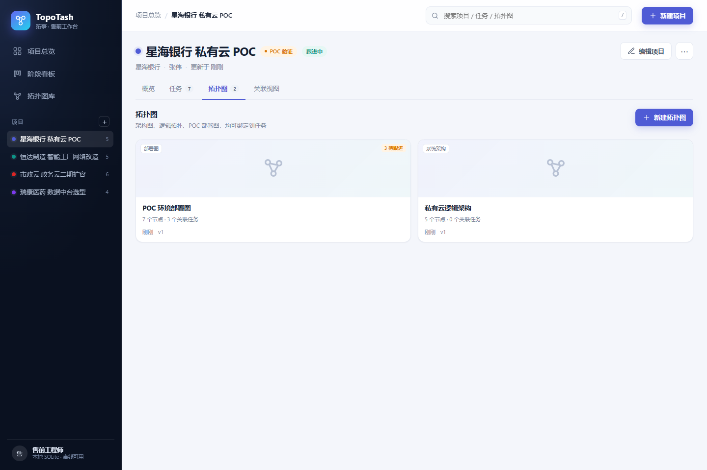
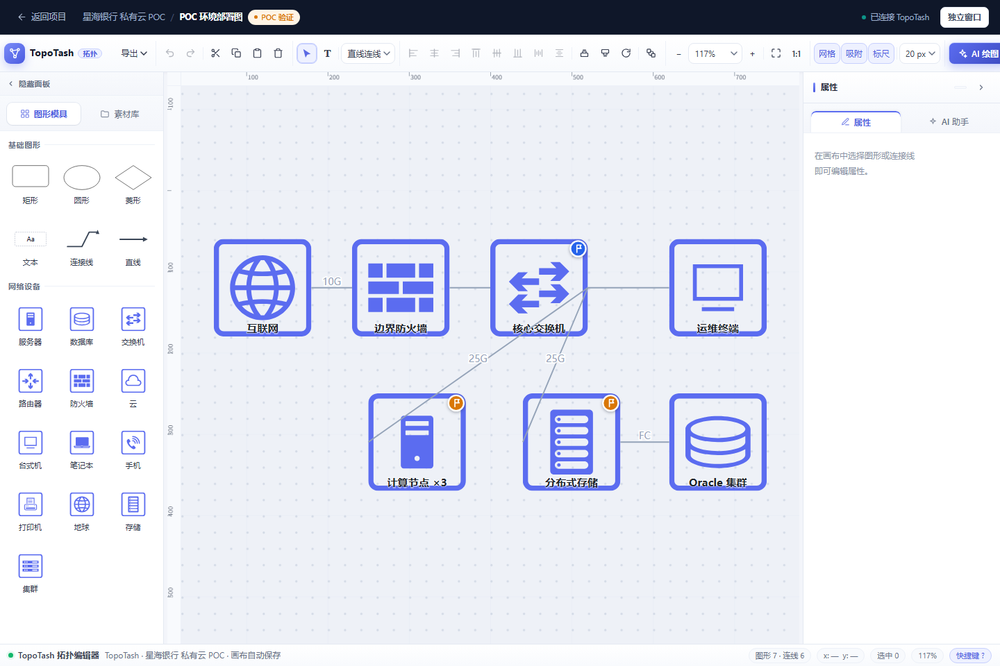
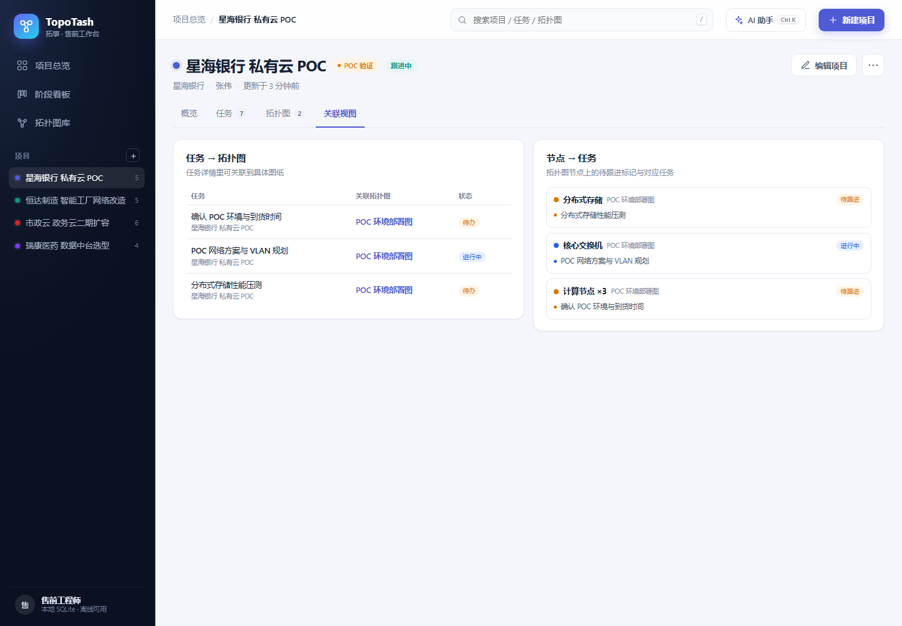

# TopoTash 拓事

> 面向 IT 售前工程师的项目工作台：**项目 → 任务 → 拓扑图** 放在同一条线上。

TopoTash 是一个自带后端的完整 Web 应用。每个项目下有多个任务和多张拓扑图；任务可以关联图纸，拓扑图节点可以标记「待跟进」并直接创建或跳转到任务；所有视图都可以按售前阶段聚合。

- 项目总览、阶段看板、拓扑图库（新建 / 导入 / 复制 / 绑定项目；支持暂不绑定项目的库内图纸）、项目工作台
- 原生任务台：按售前阶段分组的列表、状态看板、优先级、子任务、标签、搜索、任务↔图纸↔节点关联
- 全局 AI 助手：一处配置 OpenAI 兼容 API，向导式新建项目、管理任务；所有写入先生成草稿，确认后执行
- 拓扑编辑器：系统架构图、逻辑拓扑、POC 部署图，节点级任务联动；只保留 PNG / SVG / reveal.js 片段三种导出，画布自动保存到 TopoTash
- SQLite 持久化，数据全部落在项目根目录，离线可用



## 界面预览

| 阶段看板 | 项目工作台（任务列表） |
|---|---|
|  |  |

| 任务详情 | 任务看板 |
|---|---|
|  |  |

| 项目概览 | 拓扑图库 |
|---|---|
|  |  |

| 拓扑编辑器（节点跟进） | 关联视图 |
|---|---|
|  |  |

## 快速开始

环境：Python 3.10+（开发时使用 3.15），浏览器用 Chrome / Edge。

### Windows 一键首次启动

双击项目目录里的 **`首次启动.bat`**，向导会依次完成：

1. 检查 Python 版本（≥ 3.10）与依赖；缺少 Flask 时自动执行 `pip install -r requirements.txt`
2. 初始化 `topotash.db`（幂等，已有数据库不会被清空）
3. 数据库为空时写入 4 个示例项目 / 23 个任务 / 5 张拓扑图；已有项目则跳过
4. 在桌面创建「TopoTash 拓事」快捷方式，图标使用 `static/topotash.ico`

之后双击桌面上的「TopoTash 拓事」即可启动：控制台会拉起本地服务并自动打开浏览器。重复双击只会重新打开页面，不会启动第二个实例；在服务窗口按 `Ctrl+C` 或关闭窗口即可停止。

向导也可以手动运行，便于指定数据库或跳过某些步骤：

```bash
python setup_first_run.py                      # 等同双击首次启动.bat
python setup_first_run.py --db D:\data\tt.db   # 换数据库位置
python setup_first_run.py --no-shortcut        # 只初始化，不建快捷方式
python setup_first_run.py --help               # 全部参数
```

启动器本身也可以直接使用：

```bash
python start_topotash.py                # 启动并打开浏览器（127.0.0.1:5000）
python start_topotash.py --port 5050    # 换端口
python start_topotash.py --debug        # Flask 调试模式
```

> 快捷方式记录的是当前 Python 解释器路径和项目绝对路径。更换 Python、移动项目目录后，重新双击 `首次启动.bat` 即可更新。

### 手动启动

```bash
# 1. 安装依赖（只有一个 Flask）
python -m pip install flask

# 2. 初始化数据库（生成 topotash.db；首次启动也会自动创建）
python app.py init-db

# 3. 可选：写入 4 个示例项目 / 23 个任务 / 5 张拓扑图
python app.py seed-demo

# 4. 启动（debug，127.0.0.1:5000）
python app.py
```

打开 <http://127.0.0.1:5000>。数据库默认在 `./topotash.db`，可用 `TOPOTASH_DB` 环境变量覆盖。

> 本应用没有登录与权限控制，默认只监听 `127.0.0.1`，请勿直接暴露到公网。

## 测试

测试只用标准库 `unittest`，不需要额外依赖；每个用例都会新建临时 SQLite 数据库，不会读写 `topotash.db`。

```bash
python -m unittest discover -s tests -t . -v
```

覆盖范围：

- 项目 / 任务 / 拓扑图的增删改查、过滤、级联删除与错误响应
- 原生任务台的标签、子任务、任务↔图纸关联、任务台全量状态桥接
- 画布保存、节点索引同步、节点跟进状态、节点↔任务主任务联动
- 总览 / 阶段看板 / 关联视图 / 全局搜索、页面路由、静态资源与 JSON 错误格式
- 示例数据、历史任务/画布 JSON 迁移、`init-db` / `seed-demo` CLI
- AI 配置校验、密钥掩码、工具循环、草稿确认/取消/并发保护（模型调用用替身，不联网）

真实模型联调：启动服务后打开「AI 助手 → 设置」填写 Base、Key、模型并点「测试连接」，或直接调用 `POST /api/ai/test`。Key 只写入本地 `app_settings` 表（`topotash.db` 已被 `.gitignore` 排除），不会出现在代码或页面里。

## 功能地图

| 页面 | 路径 | 说明 |
|---|---|---|
| 项目总览 | `/` | 项目卡片、阶段筛选、统计、即将到期、节点待跟进 |
| 阶段看板 | `/board` | 四个售前阶段泳道，任务卡片可点击直达任务台 |
| 拓扑图库 | `/diagrams` | 全部项目的拓扑图，显示节点数 / 关联任务 / 待跟进数 |
| 项目工作台 | `/projects/<id>` | 概览 / 任务 / 拓扑图 / 关联视图 四个标签页 |
| 拓扑编辑器 | `/projects/<id>/diagrams/<did>` | 全屏画布，自动保存到 SQLite |

任意页面都可以点击顶部「AI 助手」或按 `Ctrl+K` 打开全局抽屉：对话、项目/任务草稿、确认执行都在这里，不再跳转旧版任务台。

## 架构说明

TopoTash 由一个 Flask 应用统一托管：

- **Shell**：Jinja 页面骨架 + 原生 JS，负责项目导航、总览、阶段看板与项目工作台。
- **原生任务台**：`static/js/tasks.js` + REST API，按项目/阶段直接读写 `tasks` 表，不再嵌套旧 TodoFlow 页面。
- **全局 AI 助手**：`static/js/ai.js` + `api/ai.py` + `services_ai.py`。浏览器只和本机 Flask 通信，模型 Key 不进入浏览器；读工具直接查库，写工具只生成 `ai_actions` 草稿，用户确认后才通过服务层落库。
- **拓扑编辑器**：自包含的 SVG 编辑器，通过桥接脚本保存画布 JSON，并在属性面板与节点上提供任务联动。
- **桥接层**：拓扑编辑器通过同源 `fetch` 调用 REST API，`postMessage` 向父页面传递保存状态与打开任务事件。
- **数据层**：Flask + sqlite3 标准库，无 ORM；`schema.sql` 是唯一建表来源。

任务台使用 TopoTash 自己的项目、阶段与关联模型；拓扑编辑器是唯一保留 iframe 的复杂画布模块。两者都是原生 JS、零框架依赖，不需要 Vue/React 适配层，也没有前端构建步骤。

## 目录结构

```
TopoTash/
├── app.py                      # Flask 入口、页面路由、CLI（init-db / seed-demo）
├── start_topotash.py           # 桌面快捷方式调用的启动器（自动开浏览器、防重复启动）
├── setup_first_run.py          # 首次启动向导：环境检查 / 建库 / 示例数据 / 快捷方式
├── 首次启动.bat                # Windows 双击入口（找到 Python 后运行上面的向导）
├── db.py                       # SQLite 连接、事务、通用工具
├── schema.sql                  # 全部建表语句（含索引、外键、CHECK）
├── services.py                 # 领域服务：项目/任务/节点同步、经典任务台状态
├── services_ai.py              # AI：全局配置、模型客户端、工具定义、Agent 循环、草稿动作
├── topotash.db                 # 运行时数据库（init-db 生成）
├── api/
│   ├── __init__.py
│   ├── projects.py             # 项目 + 经典任务台全量状态同步
│   ├── tasks.py                # 任务、子任务、标签、任务↔拓扑图
│   ├── diagrams.py             # 图纸内容、节点索引、节点跟进/关联
│   ├── views.py                # 总览、阶段看板、关联视图、全局搜索
│   └── ai.py                   # AI 配置、会话、对话、草稿确认
├── templates/                  # Jinja 页面骨架
│   ├── base.html
│   ├── dashboard.html
│   ├── board.html
│   ├── diagrams.html
│   ├── project.html
│   └── editor.html
├── static/
│   ├── favicon.svg
│   ├── topotash.ico            # 快捷方式图标（首次启动向导生成）
│   ├── css/topotash.css
│   ├── css/ai.css              # 全局 AI 抽屉与草稿卡片
│   ├── js/                     # shell / dashboard / board / project / tasks / editor / ai
│   └── apps/
│       ├── topology/           # 内置拓扑编辑器 + 桥接
│       └── tasks/              # 旧版任务台兼容页（不再有入口，仅供旧数据回看）
├── tests/                      # unittest 全量测试（临时数据库，不碰 topotash.db）
│   ├── support.py              # 测试用临时库与请求辅助
│   ├── test_api_projects.py    # 项目 CRUD 与任务台状态桥接
│   ├── test_api_tasks.py       # 任务、子任务、标签、任务↔图纸关联
│   ├── test_api_diagrams.py    # 画布保存、节点索引、节点跟进与关联
│   ├── test_api_views.py       # 聚合视图、页面路由、静态资源、错误格式
│   ├── test_services.py        # 服务层辅助函数与节点索引
│   ├── test_tools.py           # 示例数据、历史 JSON 迁移、Flask CLI
│   ├── test_setup_scripts.py   # 首次启动向导辅助函数与图标生成
│   ├── test_ai.py              # AI 草稿/确认/配置/会话（假模型，不联网）
│   └── test_ai_config.py       # AI 配置校验、工具循环、草稿生命周期
├── tools/
│   ├── seed_demo.py            # 示例数据
│   ├── data/gpu_cluster_topology.vweb.json  # 真实画布存档（示例数据里的 GPU 集群拓扑）
│   ├── migrate_json.py         # 历史 JSON 数据导入
│   └── make_icon.py            # 生成 static/topotash.ico（纯标准库，无需 Pillow）
├── docs/
│   ├── DESIGN.md               # 数据模型、Schema、API、前端架构
│   ├── API.md                  # REST API 明细
│   └── screenshots/
├── licenses/
│   └── THIRD_PARTY_NOTICES.md  # 第三方组件与许可
├── .gitignore
├── README.md
└── requirements.txt
```

## 历史数据导入

如果手头已有旧版任务 JSON 或画布 JSON，可以用迁移脚本导入：

```bash
# 导入任务 JSON 为一个 TopoTash 项目（原「项目分类」变任务分类）
python tools/migrate_json.py --todo data/todos.json --project-name "历史任务迁移"

# 每个旧分类拆成一个项目
python tools/migrate_json.py --todo data/todos.json --split-projects

# 同时导入目录下的画布 JSON（默认挂到第一个项目）
python tools/migrate_json.py --todo data/todos.json --visio data/diagrams

# 指定数据库 / 目标项目 / 阶段
python tools/migrate_json.py --todo todos.json --db my.db \
  --project-name "XX 银行" --stage poc --visio-project "XX 银行"
```

迁移脚本会保留任务 id、创建时间、子任务、标签、循环规则、AI 配置与对话记录；画布 JSON 会解析出节点索引，但不会自动建立节点-任务关联。首次打开全局 AI 助手时，会把最近一份旧 `aiConfig` 自动迁移为全局配置。

## 主要接口

完整说明见 [docs/API.md](docs/API.md)。

```
GET    /api/projects                         项目列表（含统计）
POST   /api/projects                         新建项目
GET    /api/projects/<id>                     项目详情（任务/拓扑/动态）
GET    /api/projects/<id>/todo-state          经典任务台兼容状态
PUT    /api/projects/<id>/todo-state          经典任务台全量回写（桥接/迁移用）

GET    /api/tasks?project_id=&stage=&status=  任务查询
POST   /api/tasks                             新建任务
PATCH  /api/tasks/<id>                        更新任务
POST   /api/tasks/<id>/diagrams               任务关联拓扑图
DELETE /api/tasks/<id>/diagrams/<did>         取消关联

GET    /api/diagrams?project_id=              拓扑图列表（unbound=1 查未绑定图纸）
POST   /api/diagrams                          新建拓扑图（project_id 可省略）
POST   /api/diagrams/import                   导入画布 JSON（project_id 可省略）
POST   /api/diagrams/<id>/duplicate           复制拓扑图
PATCH  /api/diagrams/<id>                     重命名 / 修改类型 / 绑定项目
GET    /api/diagrams/<id>/content             画布 JSON（含节点跟进信息）
PUT    /api/diagrams/<id>/content             保存画布 JSON（同步节点索引）
POST   /api/diagrams/<id>/nodes/<key>/followup 标记节点 / 创建或关联任务
DELETE /api/diagrams/<id>/nodes/<key>/links/<task_id> 取消节点任务关联

GET    /api/views/overview                    总览聚合
GET    /api/views/stage-board                 阶段看板
GET    /api/views/links                       任务↔图 / 节点↔任务
GET    /api/views/search?q=                   全局搜索

GET    /api/ai/config                         全局 AI 配置（Key 仅返回掩码）
PUT    /api/ai/config                         保存全局 AI 配置
POST   /api/ai/test                           测试模型连接
GET    /api/ai/conversations                  对话列表
POST   /api/ai/conversations                  新建对话
GET    /api/ai/conversations/<id>             对话详情（消息 + 草稿）
DELETE /api/ai/conversations/<id>             删除对话
POST   /api/ai/chat                           发送消息（服务端代理模型 + 工具循环）
POST   /api/ai/actions/<id>/confirm           确认执行草稿
POST   /api/ai/actions/<id>/cancel            取消草稿
```

## 设计说明

- 技术选型：Flask 3 + sqlite3 标准库 + Jinja + 原生 JS，无 ORM、无前端构建步骤，便于本地运行和二次修改。
- 项目是唯一枢纽：任务与拓扑图都必须挂在项目下，跨项目查询由聚合接口完成。
- 节点索引：`diagram_nodes` 不是画布副本，而是从 `content_json` 解析出的「可检索节点」，保存画布时增量 upsert、删除已不存在的节点。
- 节点角标状态：`diagram_nodes.followup_status` 与主任务状态联动；任务完成时自动把角标改成「已完成」。
- 自动保存：拓扑编辑器每次 `commit()` 后 900ms 防抖 PUT；原生任务台按操作立即 PATCH/POST，项目统计通过事件刷新。
- 任务台不再嵌套 TodoFlow：列表按售前阶段分组，看板按状态分列，任务详情直接管理子任务、标签、关联图纸和拓扑节点。
- 全局 AI 两阶段写入：读工具直接查询；`create/update/delete` 工具只生成 `ai_actions` 草稿，用户在抽屉里改字段并点确认后才调用 `services.py` 落库，失败不会留下半成品。
- AI 配置只存一份：`app_settings.ai_config`，首次打开会自动迁移最近一个项目的旧 `aiConfig`；模型请求由 Flask 转发，Key 不回传浏览器。
- AI 会话和草稿持久化在 `ai_conversations/ai_messages/ai_actions`，刷新页面或切换项目仍可继续。

## 已知限制

- 单用户本地应用，没有认证 / 多租户 / 冲突合并；同一个项目不要同时在两个浏览器里编辑。
- 拓扑图缩略图暂用占位图，未生成真实 PNG 预览。
- AI 首版为非流式输出（等待完整回复）；拓扑图相关的 AI 操作为只读，任务与项目支持读写。
- AI 模型需支持 OpenAI 兼容的 `tools` / function calling，否则无法生成项目/任务草稿。
- API Key 以明文保存在本地 SQLite；本应用默认只监听 `127.0.0.1`，请勿直接暴露到公网。
- 删除项目会级联删除任务、拓扑图与关联，界面有二次确认；AI 删除项目同样需要确认草稿。
- `static/apps/tasks/` 旧版任务台不再有入口，仅保留用于回看历史数据；其 AI 面板已不再使用。

## 许可

内置拓扑编辑器包含 ELK.js（EPL-2.0）、web-worker（Apache-2.0）、Affinity 图标集（The Unlicense）等第三方组件，许可与版权声明见 [licenses/THIRD_PARTY_NOTICES.md](licenses/THIRD_PARTY_NOTICES.md)。
