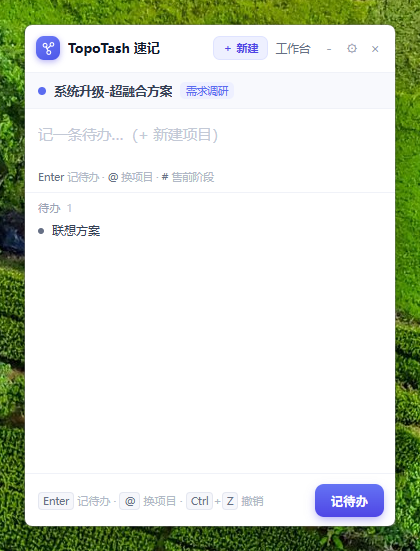
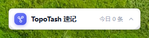
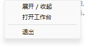

# TopoTash 速记

> 常驻桌面的小浮窗：一行输入，把「待办」直接记进当前项目。
> 无边框、始终置顶、不占任务栏、右下角托盘；`Ctrl+Alt+N` 随时呼出。



收起后只剩一条标题栏，点一下展开：



托盘右键菜单：



---

## 1. 交互速查

| 你做什么 | 结果 |
|---|---|
| 直接打字 + `Enter` | 在当前项目里建一条**待办** |
| `+` 开头 | 新建项目（`+ 项目名 @客户 /阶段`，回车即建） |
| `@` | 项目选择器；选中后**立刻切换**，下面换成该项目的待办 |
| `#` | **售前阶段**选择器：需求调研 / 方案编写 / POC 验证 / 招投标 |
| `↑` `↓` | 选择器里移动 |
| `Enter` | 确认选择器 / 提交 |
| `Esc` | 关选择器 → 取消新建 → 收起窗口 |
| `Ctrl+Z` | 撤销刚建的任务/项目（输入框为空时） |
| `Ctrl+Alt+N` | 全局热键：隐藏→显示、收起→展开、其他→收进托盘 |
| `－` | 收起成 260×44 的悬浮标题栏 |
| `⚙` | 设置：开机自启 |
| `×` | 收进托盘（不退出） |
| 按住标题栏拖动 | 移动窗口 |

**关于 Tab**：已取消。中文输入法会抢占 Tab 切候选词，主确认键统一为 `Enter`。

### 记录去哪了

不是「进展流水」，而是项目的**任务**：

| 你输入 | 落库 |
|---|---|
| `确认 POC 环境` | `tasks.title = 确认 POC 环境`，`status = todo` |
| `#方案编写 输出选型对比` | `tasks.stage = proposal`（没有 `#` 时用项目当前阶段） |
| `@星海 约评审` | 记到「星海」项目（并切换过去） |
| `+ 恒达制造 智能工厂 @恒达 /poc` | 新建项目（客户=恒达，阶段=POC 验证） |

记完立刻出现在浮窗的「待办」列表和项目页的「任务」tab 里。

---

## 2. 窗口行为

| 行为 | 实现 | 说明 |
|---|---|---|
| 无边框 / 置顶 | pywebview `frameless + on_top` | 覆盖在普通窗口之上 |
| 不进任务栏 | `WS_EX_TOOLWINDOW` | 任务栏和 Alt+Tab 都没有它 |
| 托盘图标 | `tray_icon.py`（ctypes `Shell_NotifyIconW`） | 左键显示/隐藏，右键菜单 |
| 收起 | `SetWindowPos` 缩成 260×44 | 贴住右上角，仍置顶 |
| 展开 | 还原到收起前尺寸 | 最小 380×520，防止标题栏按钮被裁 |
| 拖动 | 前端按位移发 `move`，后端 `SetWindowPos` | 不用模态拖拽循环 |
| 位置记忆 | `%LOCALAPPDATA%\TopoTash\window.json` | 收起状态下保存的是展开尺寸 |
| 单实例 | 命名互斥量 `Global\TopoTashCapture` | 重复启动会唤起已有窗口 |
| 开机自启 | `HKCU\...\Run` → `TopoTashCapture` | 在 `⚙` 里开关 |

---

## 3. 运行方式

```bash
python start_topotash.py                 # 只开本地服务（浏览器用）
python start_topotash.py --floating      # 服务 + 桌面浮窗（需要 pywebview）
python start_topotash.py --floating --port 5001
```

- 依赖：`requirements.txt` + `requirements-floating.txt`（`pywebview>=6.2`），需要 WebView2 运行时
- 桌面快捷方式「**TopoTash 速记**」= `pythonw.exe start_topotash.py --floating --no-browser`
- 日志：`%LOCALAPPDATA%\TopoTash\app.log`
- 数据库：默认 `topotash.db`，可用 `TOPOTASH_DB` 环境变量覆盖

浏览器里也能用同一套界面：`http://127.0.0.1:5000/capture`（宽屏时显示成一张卡片）。

---

## 4. 接口

| 方法 | 路径 | 用途 |
|---|---|---|
| GET | `/capture` | 速记页面（`?shell=1` 时显示窗口按钮） |
| POST | `/api/tasks` | 建任务（速记的「记录」） |
| GET | `/api/tasks?project_id=` | 浮窗下面的待办列表 |
| DELETE | `/api/tasks/<id>` | 撤销 |
| POST | `/api/projects` | `+` 新建项目 |
| GET | `/api/projects` | `@` 项目列表 |
| POST | `/api/capture/window` | 窗口动作：`collapse` / `expand` / `move` / `hide` / `show` / `close` |
| GET | `/api/capture/state` | 窗口状态：`collapsed` / `hidden` / `tray` / 坐标 |
| GET·PUT | `/api/capture/autostart` | 开机自启 |

建任务示例：

```bash
curl -X POST http://127.0.0.1:5000/api/tasks \
  -H "Content-Type: application/json" \
  -d '{"project_id":"p_xxx","title":"确认 POC 环境","stage":"poc","source":"floating"}'
```

---

## 5. 排错

| 现象 | 原因 / 处理 |
|---|---|
| 托盘图标找不到 | Win11 会把新图标放进「^」溢出区：任务栏设置 → 其他系统托盘图标 → 打开「TopoTash 速记」 |
| 点托盘菜单没反应 | 看日志有没有 `[速记] 托盘动作失败：...`；托盘动作的异常会被兜住并记录 |
| 热键无效 | `Ctrl+Alt+N` 被别的软件占用，日志会打印「注册失败」 |
| 双击快捷方式没反应 | 已经在运行（单实例），会唤起现有窗口；重复进程会被互斥量挡住 |
| 窗口不见了 | 可能收进托盘了：`Ctrl+Alt+N` 或托盘左键 |
| 日志在哪 | `%LOCALAPPDATA%\TopoTash\app.log` |

---

## 6. 测试

```bash
python -m unittest discover -s tests
```

与速记相关的用例：

| 文件 | 覆盖 |
|---|---|
| `tests/test_capture_page.py` | 页面渲染、浮窗端点、`速记 = 建任务` 契约、项目页无「进展」tab |
| `tests/test_capture_shell.py` | 收起/展开/移动的几何计算（mock Win32） |
| `tests/test_capture_window.py` | 真实窗口上的收起/展开（屏幕外 Tk 窗口） |
| `tests/test_tray.py` | `WS_EX_TOOLWINDOW` 设置与幂等 |
| `tests/test_workbench.py` | 「打开工作台」的 URL 与浏览器调用 |

---

## 7. 相关文件

| 文件 | 作用 |
|---|---|
| `templates/capture.html` | 速记页面结构 |
| `static/js/capture.js` | 输入、选择器、提交、拖动、收起 |
| `static/css/capture.css` | 浮窗样式（含收起态 / 窄窗兜底） |
| `api/capture.py` | 窗口控制与开机自启接口 |
| `api/tasks.py` | 任务 CRUD（速记提交的目标） |
| `quick_capture.py` | pywebview 壳、热键、单实例、托盘启动、位置记忆 |
| `tray_icon.py` | 托盘图标 + 任务栏隐藏（纯 ctypes） |
| `start_topotash.py` | `--floating` 入口 |

设计演进与踩坑记录见 [feasibility-capture.md](feasibility-capture.md)，
原型图见 [prototypes/](prototypes/)。
